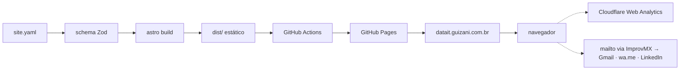

# Briefing do projeto

Seções 2 (A ideia, sem o conteúdo aprovado) e 3 (Decisões já tomadas) do prompt de construção, copiadas sem alteração em 2026-10-28. O conteúdo aprovado dos textos do site está em `docs/approved_content.md`.

**Conferido em 2026-10-28 (primeira sessão):** tudo o que está em **O que já existe no código** confere, com uma exceção: a `main` antiga e a `release/guizani-data-it` compartilham o commit raiz `af964a6` ("Initial commit", 2022-01-08, só o `.gitattributes`); fora ele, os históricos são independentes (3 commits só na `release`, 21 só na `main`). A regra de nunca usar `push --force` na `main` continua valendo.

## 2. A ideia

### Objetivo

- **Para quem:** clientes que podem contratar a Guizani Data IT e recrutadores.
- **Marca:** o site é da Guizani Data IT e é centrado no usuário (Davi Guizani): a marca da empresa vem na frente, e ele aparece como o engenheiro de dados por trás dela.
- **Problema:** o site atual não mostra o tamanho real da experiência do usuário em engenharia de dados (poucos projetos, visual simples), então não serve de cartão de visita nem para vender os serviços nem para candidaturas.
- **Ação principal do visitante:** entrar em contato (e-mail, WhatsApp ou LinkedIn); o currículo em PDF é uma opção secundária.
- **Idioma do conteúdo:** português e inglês, com um seletor de idioma.
- **O que é sucesso:**
  - no celular, um visitante descobre em até 30 segundos o que o usuário faz, as principais tecnologias de dados dele e como entrar em contato;
  - todos os projetos aprovados aparecem com o problema, o papel do usuário e a stack;
  - incluir um projeto novo é editar o arquivo de dados, sem mexer no HTML nem no CSS, e leva menos de 10 minutos;
  - o Lighthouse dá nota 90 ou mais em performance, acessibilidade e SEO, no perfil de celular.

### O que já existe no código

Análise de 2026-10-28, feita no clone local depois de um `git fetch --prune`. Confira cada ponto antes de se apoiar nele.

- **Repositório:** `dguizani/curriculo_html`, público, com a descrição "Meu currículo". O remote do clone ainda aponta para `https://github.com/EmployingDGC/curriculo_html.git` (nome antigo da conta), que funciona porque o GitHub redireciona.
- **GitHub Pages:** publica a branch `release/guizani-data-it`, na raiz, com o build `legacy` (sem GitHub Actions). O domínio `datait.guizani.com.br` tem o certificado HTTPS aprovado (renovado pelo GitHub), mas o "Enforce HTTPS" está desligado.
- **Branches:**
  - `release/guizani-data-it` (publicada): landing page da Guizani Data IT com 5 arquivos (`index.html`, `style.css`, `logo_1.png`, `CNAME`, `.gitattributes`). HTML e CSS puros, fonte Roboto do Google Fonts, azul `#007BFF`. Seções: cabeçalho, hero com o logo e o botão "Vamos Conversar", Sobre Mim, três cards de serviços, Contato (só o LinkedIn; e-mail e WhatsApp comentados com valores de exemplo) e rodapé com o CNPJ. Só em português; sem projetos, tecnologias, favicon, meta description nem Open Graph.
  - `main` (padrão do repositório): o currículo antigo em inglês, com o `CNAME` apontando para `davi.guizani.com.br`, que não existe no DNS. A `main` local está 2 commits atrás da `origin/main`. Tem o texto das experiências na Unimed de Goiânia e na Integral Médica e a foto `images/perfil-1.fw.png`, de 9,7 MB (não reaproveitar: o usuário entrega uma foto nova).
  - `release/landing_page`: já mergeada na `main` (PR #4), sem nada a mais.
- **DNS** (2026-10-28): o `guizani.com.br` usa o DNS do Registro.br (`b.sec.dns.br` e `c.sec.dns.br`) e não tem registro MX. O `datait.guizani.com.br` aponta para o GitHub Pages por quatro registros A (`185.199.108.153` a `185.199.111.153`).
- **Convenções:** nenhuma a preservar. Os commits antigos não seguem padrão, e não há documentação, testes, lint nem CI.

### Escopo

- **MVP** (tamanho médio):
  1. linha de base: arrumar as branches e o repositório sem mudar o site no ar;
  2. nova identidade visual (paleta, tipografia, logo, tema claro e escuro);
  3. estrutura do site com um arquivo de dados único (projetos, serviços, skills, linha do tempo, laboratório e textos da interface), em português e inglês;
  4. seções: hero, sobre, serviços, projetos principais, participação pontual, linha do tempo, skills, laboratório e contato;
  5. seletor de idioma PT/EN;
  6. contato (e-mail, WhatsApp e LinkedIn) e currículo em PDF, feito à parte pelo usuário e só linkado;
  7. SEO e qualidade: meta description, Open Graph, favicon, sitemap e Lighthouse 90 ou mais;
  8. contagem de visitas com um serviço gratuito, sem cookies;
  9. lançamento: Pages publicado pelo GitHub Actions, "Enforce HTTPS" ligado e o domínio verificado.
- **Futuro** (não construir agora): filtro dos projetos por tecnologia; LaudAI na linha do tempo (como RPA, quando houver commits do usuário nele); página de estudo de caso por projeto; currículo em PDF gerado do arquivo de dados; formulário de contato; artigos técnicos; depoimentos de clientes; laboratório atualizado pela API do GitHub.
- **Fora do escopo:** backend próprio, área logada, CMS, pagamento ou orçamento online e qualquer serviço com custo mensal.

### Funcionalidades do MVP

- **Identidade visual:** técnica e sóbria, nas cores do Python (azul e amarelo) sobre uma base escura, com Inter nos textos e JetBrains Mono nos detalhes técnicos (stack, datas). Referências que o usuário entrega: a foto de perfil (fundo cinza-escuro, camiseta preta) e o banner do LinkedIn (fundo quase preto com tom verde-azulado, linhas de circuito brilhantes em amarelo-claro, texto binário como textura e "DATA ENGINEER" em amarelo e azul).
  - **Paleta** (confira os tons e o contraste na construção):

    | Papel | Escuro (padrão) | Claro |
    |---|---|---|
    | Fundo | `#0B1215` | `#F7F9FA` |
    | Superfície (cards) | `#121C21` | `#FFFFFF` |
    | Azul Python (primária) | `#4B8BBE` | `#306998` |
    | Amarelo Python (destaque, botões) | `#FFD43B`, com texto escuro | `#FFD43B` só como fundo de botão, com texto escuro |
    | Texto | `#E6EDF0` | `#14212A` |
    | Texto secundário | `#9AA9B0` | `#4A5A63` |

    No tema claro, o amarelo nunca é cor de texto (não passa no contraste sobre o branco).
  - **Imagens:** a foto de perfil entra na seção Sobre, otimizada no build. O banner é só inspiração: as linhas de circuito e o texto binário são redesenhados em SVG leve (`CircuitBackground`), como fundo discreto do hero.
  - **Marca do Python:** só as cores, nunca o logo do Python (marca registrada da Python Software Foundation), nem no hero, nem no favicon, nem no logo da empresa. O Python aparece como texto na lista de skills.
- **Logo:** novo, simples e tipográfico (ex.: monograma ou o nome em fonte própria), em SVG, trocando de cor conforme o tema. Debata as opções com o usuário.
- **Tema claro e escuro:** segue o tema do sistema do visitante, com um botão para trocar; a escolha fica salva no navegador. O script do tema fica inline no `<head>`, para a página não piscar no tema errado.
- **Idiomas:** português em `/` e inglês em `/en/`, sem redirecionamento automático; links `hreflang` para os buscadores; o seletor fica sempre visível.
- **Seções, nesta ordem:** hero, sobre (curto), serviços, projetos principais, participação pontual, linha do tempo, skills, laboratório e contato, mais o rodapé.
- **Hero:** a marca Guizani Data IT, uma frase de posicionamento (proponha opções ao usuário) e dois botões: "Vamos conversar" (contato) e "Ver projetos".
- **Cards dos projetos principais:** cliente (com "via ITIX"), título, período, problema, papel e stack.
- **Contato:**
  - **E-mail:** um endereço no domínio (sugestão: `contato@guizani.com.br`, a confirmar com o usuário) com encaminhamento gratuito pelo ImprovMX para o Gmail do usuário; as respostas saem do Gmail.
  - **WhatsApp:** (27) 99794-2740, pelo link `https://wa.me/5527997942740` com a mensagem pronta "Olá, Davi! Vi o site da Guizani Data IT e gostaria de conversar sobre um projeto de dados." (em inglês: "Hi, Davi! I saw the Guizani Data IT website and would like to talk about a data project.").
  - **LinkedIn:** <https://www.linkedin.com/in/davi-guizani/>.
  - **Currículo:** dois PDFs, um por idioma, feitos pelo usuário; o link segue o idioma da página.
- **Rodapé:** o CNPJ da Guizani Data IT (62.058.173/0001-18), os links do LinkedIn e do GitHub (<https://github.com/dguizani>) e o aviso "Este site conta visitas de forma anônima, sem cookies." (em inglês: "This site counts visits anonymously, without cookies.").
- **Arquivo de dados único** (`src/data/site.yaml`) com tudo o que aparece no site, nos dois idiomas lado a lado; incluir um projeto não exige mexer no HTML nem no CSS.
- **SEO e qualidade:** meta description, Open Graph com uma imagem por idioma (1.200 × 630, com o logo, o nome e o posicionamento), favicon, sitemap, `robots.txt` e Lighthouse 90 ou mais em performance, acessibilidade e SEO, no celular.
- **Contagem de visitas:** Cloudflare Web Analytics (sem cookies, só um script).

### Tecnologias

- **Astro** (última versão estável na construção), gerando um site estático. Não usar: gerador próprio em Python (idiomas, validação e otimização de imagens à mão), Hugo (templates em Go pouco legíveis), HTML com JS montando a página a partir de um JSON (piora o SEO), MkDocs ou Pelican (voltados a documentação e blog).
- **TypeScript** nos componentes e no schema dos dados.
- **CSS puro**, com variáveis para a paleta e os dois temas. Não usar Tailwind.
- **YAML** no arquivo de dados, validado no build por um schema **Zod**: um campo faltando ou sem a versão em inglês quebra o build.
- **Fontes:** Inter e JetBrains Mono, servidas pelo próprio site (pacotes `@fontsource`), sem o Google Fonts.
- **Contagem de visitas:** Cloudflare Web Analytics. Alternativa já avaliada, caso o plano mude: Umami.
- **E-mail:** ImprovMX (registros MX e TXT no Registro.br). Não usar o Cloudflare Email Routing, que exigiria mover o DNS para a Cloudflare. Alternativa já avaliada: Forward Email.
- Confira os limites dos planos gratuitos do Cloudflare Web Analytics e do ImprovMX antes de configurar.

### Padrões de código

- **Tipagem:** TypeScript em tudo o que a linguagem permitir (componentes, funções e schema), com o `tsconfig` `strictest` do Astro.
- **Comentários:** nenhum comentário no código; só docstrings TSDoc (`/** ... */`), em português, obrigatórias em toda função, componente e tipo exportado. Nos `.astro`, um bloco no início do frontmatter diz o que o componente mostra, e a interface `Props` tem cada campo documentado. No schema do YAML, cada campo tem descrição, para guiar quem edita o arquivo de dados.
- **Lint e formatação:** ESLint (com `typescript-eslint` e `eslint-plugin-astro`) e Prettier (com `prettier-plugin-astro`, formatando também o CSS e o YAML). Não usar Biome nem gts.
- **CSS:** cada componente Astro tem o próprio estilo, com escopo; um arquivo global guarda só os tokens (paleta, fontes, espaçamentos) e o reset. Classes em `kebab-case`, medidas em `rem`, layout pensado primeiro para o celular. Não usar CSS global com BEM.
- **Nomes:** código e estrutura em inglês; componentes em `PascalCase.astro`; os demais arquivos em `kebab-case`.
- **Padrões próprios do usuário:** nenhum além do guia e das regras acima.

### Arquitetura

Site estático, sem backend. No navegador rodam só dois scripts pequenos: o do tema (inline no `<head>`) e o do analytics.

```
src/
  data/site.yaml          # todo o conteúdo, PT e EN lado a lado, inclusive os textos da interface (seção de interface)
  data/schema.ts          # schema (Zod) que valida o YAML no build
  layouts/Base.astro      # <head>: SEO, hreflang, Open Graph, script do tema, analytics
  components/             # Header, LanguageSwitch, ThemeToggle, Hero, About, Services,
                          # ProjectCard, Projects, OccasionalWork, Timeline, Skills, Lab,
                          # Contact, Footer, CircuitBackground (SVG do hero)
  pages/index.astro       # português, em /
  pages/en/index.astro    # inglês, em /en/
  styles/tokens.css       # paleta dos dois temas, fontes, espaçamentos
  styles/reset.css
public/                   # CNAME, favicon, PDFs dos currículos, imagens Open Graph, robots.txt
```



- **Textos da interface** (títulos das seções, rótulos dos botões, textos de acessibilidade): numa seção própria do `site.yaml`; o schema garante que nada fique sem tradução.
- **Imagens:** a foto é otimizada no build (`astro:assets`, AVIF e WebP em tamanhos responsivos).

### Como subir

- **Onde roda:** GitHub Pages, no domínio `datait.guizani.com.br`. Custo zero: o Pages é gratuito para repositório público, e o repositório **precisa continuar público**.
- **Deploy:** GitHub Actions com o fluxo oficial do Pages (`actions/configure-pages`, `actions/upload-pages-artifact` e `actions/deploy-pages`). A origem do Pages muda de "branch" (build `legacy`) para "GitHub Actions" só no lançamento; nenhum arquivo gerado vai para o git. Não usar build local com commit do `dist/` numa branch `gh-pages`.
- **CI antes de publicar:** ESLint, Prettier (`--check`), `astro check` (tipos e schema), o build e o **Lighthouse CI**, que barra o deploy se performance, acessibilidade ou SEO ficarem abaixo de 90 no perfil de celular.
- **Até o lançamento:** o Pages continua servindo a `release/guizani-data-it`, congelada, e o workflow de deploy só roda manualmente (`workflow_dispatch`). No lançamento, ele passa a rodar a cada push na `main`.
- **Node:** a linha LTS 26, com **piso na 26.12.1**, a versão que corrige os 10 CVEs do aviso de segurança do Node de 2026-10-21 (o mais grave, CVE-2026-111497, é uma escrita fora dos limites no decodificador Brotli que pode levar a execução remota de código). Antes de fixar a versão, confira no aviso de segurança mais recente do Node (<https://nodejs.org/en/blog/vulnerability>) se não há correção mais nova, e mostre ao usuário a versão escolhida. A versão fica no `.nvmrc` e no `engines` do `package.json`, e o CI usa a mesma (`actions/setup-node` com `node-version-file`). O gerenciador de pacotes é o **npm**.
- **Node na máquina do usuário:** nada de Node instalado no sistema. Todos os comandos (`npm install`, `npm run dev`, lint, build, testes, Lighthouse) rodam num contêiner Docker com a imagem oficial `node` na mesma versão do `.nvmrc`, com a pasta do projeto montada como volume e a porta do servidor de desenvolvimento do Astro exposta (o Docker já está instalado). Documente os comandos no README e no `tests/README.md`.
- **Repositório:** renomeado de `curriculo_html` para `guizani-data-it`, com uma descrição nova nos dois idiomas. Renomear não afeta o site: o domínio continua configurado no repositório, e o GitHub redireciona o remote antigo. Depois de renomear, atualize o remote do clone com `git remote set-url origin https://github.com/dguizani/guizani-data-it.git`.
- **Domínio e segurança:** ligar o "Enforce HTTPS"; verificar o domínio no GitHub (registro TXT no Registro.br), para ninguém conseguir apontar o `datait` para outro site no GitHub; e trocar os quatro registros A por um CNAME `dguizani.github.io`, como o GitHub recomenda para subdomínios.
- **Dependabot:** alertas de segurança e atualização semanal das dependências do npm, das GitHub Actions e da imagem do Docker.

### Dependências externas

Todas são ações do próprio usuário em serviços externos (ver a seção 4).

### Riscos e restrições

- **Nomes dos clientes:** citar os clientes pelo nome é uma decisão do usuário, que conhece as condições de cada contrato. Se algum cliente pedir para sair, o campo `cliente_publico` troca o nome pelo setor, e o site é publicado de novo em minutos. Nunca registre no repositório (código, YAML, arquivos de controle, commits) detalhes de contratos, valores ou dados pessoais além dos que aparecem no site.
- **Confidencialidade do trabalho:** nada de detalhes internos, números do negócio, prints ou código dos clientes. Você não tem acesso aos repositórios dos clientes, e o conteúdo dos cards já está aprovado.
- **Serviços gratuitos:** o ImprovMX e o Cloudflare podem mudar de plano; o Forward Email e o Umami são as alternativas já avaliadas.
- **Dados de contato públicos:** o telefone, o e-mail e o CNPJ ficam públicos, o que traz algum spam; o filtro do ImprovMX e o link `wa.me` reduzem isso.
- **Prazo:** sem prazo fixo; o site atual continua no ar até o novo ficar pronto.

## 3. Decisões já tomadas

Não rediscuta sem um motivo novo:

- Construir no próprio repositório, no GitHub Pages; construtores sem código (Framer, Webflow, Wix) e só perfis prontos (LinkedIn, README do GitHub) ficam descartados.
- Marca Guizani Data IT, centrada no usuário; público: clientes e recrutadores; ação principal: contato.
- Site em português e inglês; o usuário escreve os textos do jeito dele, e você recomenda a versão nos dois idiomas.
- Entram só os projetos com commits do usuário; projetos com poucos commits vão para a participação pontual; RPAs só na linha do tempo; projetos pessoais de dados no Laboratório.
- Clientes pelo nome, com "via ITIX", e o campo `cliente_publico` como saída rápida.
- Os textos dos cards, os quatro serviços e o agrupamento das skills estão aprovados (seção 2).
- Escopo do MVP, Futuro e Fora do escopo da seção 2; o filtro por tecnologia e o estudo de caso ficam para o Futuro.
- Astro, TypeScript `strictest`, CSS puro, YAML validado por Zod, Inter e JetBrains Mono servidas pelo site, Cloudflare Web Analytics e ImprovMX.
- ESLint e Prettier; TSDoc obrigatório; nenhum comentário.
- Identidade nas cores do Python sobre base escura, logo novo em SVG, tema do sistema com botão; nunca o logo do Python.
- Português em `/` e inglês em `/en/`, sem redirecionamento automático.
- GitHub Actions com Lighthouse CI barrando abaixo de 90; repositório renomeado para `guizani-data-it`; domínio verificado e CNAME no Registro.br.
- Node 26 LTS com piso na 26.12.1, npm, e Node só em Docker na máquina do usuário.
- Arquivos de controle no git; commits em inglês com o ID no escopo; direto na `main` depois da linha de base; sem tags.

